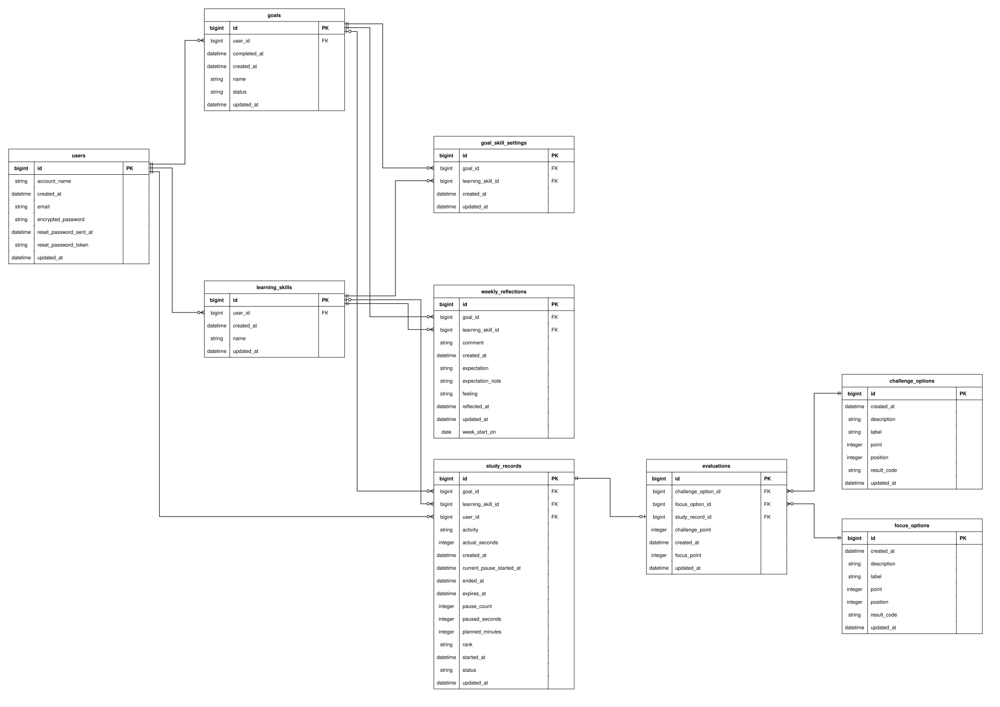

# MySkillLab

<!-- OGP 画像はここに置く（企業向けの更新で追加） -->

**毎日の学習の工夫を、見つけて、試して、残す。**

MySkillLab は、仕事の休み時間や仕事終わり、週末のまとまった時間を使って、スキルアップや収入アップのために学ぶ忙しい社会人のためのアプリです。

学習を続けているのに、期待した成果が出なかったり続かなかったりして、モチベーションを保てず自己嫌悪を感じてしまう。そんな人に向けて、学習の成果ではなく「学習に取り組んだこと」と、少ない時間の中での試行錯誤や工夫を記録に残します。週のはじめに知りたい変化（始めやすさ・集中・決めた内容への取り組み）を選ぶと、週の記録からその変化に合わせた傾向を返します。自分に合った学び方を育てていくためのアプリです。

- サービス URL：https://trace-the-effort.onrender.com/
<!-- - テスト用アカウント：（本番で作成後に追記） -->

---

## 開発の背景

社会人時代、仕事終わりや休みの日に英語を学習していましたが、成果はすぐには見えず、続けるのが難しく何度も学習をやめては再開を繰り返してきました。またそんな自分に罪悪感や劣等感を抱く事もありました。それでも、コツコツと学習を続け、ワーキングホリデーで英語環境に身を置いたときも学習を続けてしばらくすると、気づくと英語で問題なく日常生活を送れるようになっていました。その時に、成果はすぐには見えなくても、日々の取り組みと工夫は積み重なっていたのだと実感することができた瞬間でした。

ただ、学習期間中に活用していた、学習サポートアプリやツール、エクセルや日々の学習の計画や振り返りノートを、改めて次の学習で参考にしようと振り返ってみると、「私がどんな時に学習に集中」ができてて、「どんな工夫が学習継続に効果」があったか、Todoやエクセルの学習記録には「単に達成した週ごとのタスクの数」や「先週との成長率」だけで、数字は溜まっていても「今週はなぜできたのか」を思い出せませんでした。ノートにまとめた考えを見返すのも、働きながら学習をしていた私には手間でした。

数字だけでなく、その数字を生んだ工夫を残し、週ごとに見返せる仕組みがあれば、自分に合う学び方を見つけられる。そう考えて、このアプリを作りました。

---

## 解決したい課題

**学習を成果だけで測ると、成果が出ない時期の頑張りも、成果が出たときに何が効いたのかも見えなくなる。**

### 学習者の課題
- 短い時間でしか学習できない社会人は、成果をすぐに感じにくく、成果が出ないと自分を責めて、やる気が続かなくなる
- 成果が出ても、どの工夫が効いたのかが分からず、次に生かせない
- 学習時間や達成した数は残っても、その数字を生んだ工夫は残らない

### 既存のツールの課題
- 学ぶ内容ごとに記録がばらばらになり、全体を見返しにくい
- Notion・Todo アプリ・Excel・カレンダーは多機能だが、管理すること自体が負担になり、振り返りが続かない
- ノートに書いても、あとで探して見返すのが手間になる
- 続けられなかった日が目立ち、罪悪感につながる

### 想定ユーザー
- 仕事の休み時間・仕事終わり・週末の時間を使って、スキルアップや収入アップのために学ぶ社会人
- 学習の中身は既存の教材やアプリで進めていて、一人で学習している
- 学習を続けているのに成果が見えにくく、自分を責めたり、続かなくなったりしたことがある
- 自分なりの工夫を試しているが、何が効いたのかを振り返れていない

---

## 既存サービスとの違い

学習の継続を支えるサービスの多くは、報告や達成で続ける仕組みです。MySkillLab は、成果や達成ではなく、学習で試した工夫を目標ごとに残し、週ごとに傾向を返します。

- **みんチャレ**：同じ目標を持つ人とチームを組み、毎日報告し合って続けるサービス。使ってみると、報告が継続の強制力になる一方で、疲れている日には、写真や内容を報告すること自体が手間になった。MySkillLab は、他の人への報告を前提にせず、自分の工夫と記録に向き合う。
- **MissionTodo**：Todo をミッションとして達成するとポイントがたまり、ご褒美と交換できるサービス。使ってみると、達成したかどうかが中心で、完了するとリストから消えるため、積み重ねが見えにくかった。MySkillLab は、終わったら消える達成型ではなく、目標ごとの学習で何を使ったかを残す。

---

## MVP から本リリースへ

### 本リリースで変えたこと
| 判断 | MVP | 本リリース | 理由 |
| --- | --- | --- | --- |
| 記録の単位 | 学習記録の一覧 | 目標ごとに学習スキル（自分で考えた工夫）を設定し、目標ごとに記録・集計する | 目標ごとに、取り組んだ内容と自分の記録を見たいというフィードバックがあった |
| 振り返り | 自分で履歴を見返す | 週の記録から傾向を判定し、フィードバックとして返す | ユーザーが一番面倒に感じるのは振り返りだと考えた。結果から傾向を返すほうが価値がある |
| Rank の位置づけ | 取り組みを評価して意欲を高める中心 | 日々の記録として残し、中心は工夫と週の傾向に置く | Rank だけでは、学習の意欲につながらなかった |
| ご褒美 | 当初の構想（MVP では見送り） | 優先度が低いと判断し、実装していない | 本リリースでは傾向の判定を優先した |
| 傾向の判定 | 記録を AI に渡して出力させる案 | Rails の判定と定型文で返す | 定型で実装できる。AI はコストと生成の時間がかかり、出力がぶれる。傾向を返すには正確さが要る |

### MVP の仮説と結果
卒業制作の MVP では、「学習に取り組んだことを Rank で評価し、ご褒美と組み合わせれば、学習の意欲が強まるのではないか」という仮説を立て、短時間のタイマー・自己評価・Rank の判定を作りました。

友人に使ってもらうと、Rank の判定が何のためにあるのか分からず、学習の意欲が湧いたとは感じなかった、というフィードバックをもらいました。一方で、「実際に取り組んだ学習の内容や、目標ごとの自分の記録が分かるとよい」という声がありました。

そこで、目標ごとに学習スキルという単位で記録する設計にしました。さらに、ユーザーが一番面倒に感じるのは振り返りだと考え、自分で考えなくても、週の記録から傾向を判定して返す仕組みを本リリースの中心にしました。

最初の設計の良し悪しではなく、MVP で仮説を確かめ、使ってもらって分かったことから、方向を決めました。

---

## 主な機能

主な流れは目標を決め、自分で考えた学習の工夫（学習スキル）を試しながら学習し、週ごとに記録から傾向を受け取ります。

#### 目標設定機能 ─ 資格や英語の学習を始めるとき
- 「TOEIC 800点を目指す」のように、取り組む目標を1つ決める。記録は目標ごとにまとまる。

#### 学習スキル作成機能 ─ 「学習の前に軽く運動するとスイッチが入る」と気づいたとき
- その工夫を学習スキルとして登録し、目標に設定する（目標ごとに最大3つ）。学習スキルは能力ではなく、学習で試す工夫のこと。

#### 学習（タイマー） ─ 仕事終わりに15分だけ学習するとき
- 時間と今回やることを決め、試す学習スキルを1つ選んで始める。途中で止めたり、早めに終えたりできる。

#### 学習後評価と Rank判定機能 ─ 学習を終えたとき
- 集中とチャレンジを3択で答えると、取り組みが Rank（A・B・C）で返る。

#### 日々の学習スキルの振り返り機能 ─ 週末に1週間を振り返るとき
- 週のはじめに選んだ工夫と期待する変化（例：集中して取り組みたい）に合わせて、週の記録と自分の実感から傾向を返す。成果が出なかった週でも、どの工夫でどう取り組めたかが残る。

---

## こだわった実装

上の違いを支えるために、特に力を入れた実装が次の3つです。

### ① 目標ごとに記録を残して振り返れるように、学習スキルを目標ごとに設定できる設計にした
学習スキルを全体の一覧に登録するだけだと、学習を始めるときに、登録したすべてのスキルが表示されてしまい、UX として適切ではない。そこで、学習スキルはユーザーの一覧に登録し、中間テーブル `goal_skill_settings` で、目標ごとに使うものをユーザー自身が設定・解除できるようにした（同じ組は1件、1つの目標に最大3つ。場面や状況に応じて使い分けられるように）。また、MVP で「目標ごとの自分の記録が分かるとよい」という声があったため、学習を始めるときは、選んだスキルがその目標に設定されているかを検証し、学習の記録と週の集計も目標の単位で行う。

### ② 戻る・再読み込み・別のタブでも迷わないように、学習の状態に合わせて画面を切り替える設計にした
学習中なのに別のタブで学習開始の画面に行けてしまうと、ユーザーは「あれ、学習していなかったっけ」と迷ってしまう。そこで、学習記録に4つの状態（実行中・一時停止中・評価待ち・評価済み）を持たせ、状態に合わない画面へ来たら、今の状態の画面へ戻すようにした。進行中の記録はユーザーごとに1件とし、二重送信でアプリの検証を通り抜けても重複しないよう、DB の部分一意インデックスでも守る。

### ③ 振り返りを自分で考えなくても受け取れるように、記録を集計して傾向を判定するロジックを作った
学習の記録から傾向を返す仕組みを、サービスの中心に置いた。集計・判定・選択の責務は、3つの Service Object に分けた（最初は判定と選択を1つのクラスで作るつもりだったが、テストと責務の点から分けた）。忙しい社会人の1週間の学習は多くて15回ほど、少ない週は数回と想定し、回数が少ないと1回の差で割合が大きく動くため、集中・チャレンジの内訳は約3分の1（35ポイント）以上の割合の差で「変化」とみなし、同じ工夫を選んだ評価済みの記録が両方の週に3回以上ないときは比べない。

---

## 技術スタック

| カテゴリ | 技術 | 採用理由 |
| --- | --- | --- |
| 言語・フレームワーク | Ruby 3.4.9 / Ruby on Rails 8.1.4 | 認証・DB 操作・ルーティング・ビューがそろい、個人開発でも一通りの機能を Rails の中で作れる |
| フロントエンド | Hotwire（Turbo / Stimulus） | タイマーのカウントダウンを Stimulus で、画面の部分的な更新を Turbo で作れ、JavaScript を最小限にできる |
| スタイル | Tailwind CSS v4 | ユーティリティクラスで、画面の調整を素早く行える |
| テスト | RSpec | モデル・リクエスト・Service Object の振る舞いを確かめやすい |
| CI | GitHub Actions | プルリクエストのたびに、RSpec・RuboCop・Brakeman・bundler-audit を自動で実行する |
| 本番環境 | Render | Rails アプリを、少ない設定で公開できる |
| 開発環境 | Docker Compose | Ruby・Rails・DB のバージョン差によるトラブルを減らせる |

### 比較検討した技術

| 選んだもの            | 比較したもの                   | 理由                                                                          |
| ---------------- | ------------------------ | --------------------------------------------------------------------------- |
| Devise           | Rails 8 標準の認証（MVP で採用） | MVP では Rails 8 標準の認証を使っていたが、パスワード再設定などを自前で実装する必要があり、コア機能に注力するため、Devise に移行した |
| Neon（PostgreSQL） | Render の PostgreSQL      | Render の PostgreSQL は無料枠に期限があり、データを使い続けにくい                                  |
| Hotwire          | React / Next.js          | Rails と Hotwire で、タイマーや画面の更新を作れる。学習コストと工数を抑え、Rails 中心の構成にした                 |

---

## ER図

---

## 今後の展望

### サービス：比べられる指標と期間を増やし、記録から次の工夫を見つけやすくする
いまは前の週と今週を比べるだけなので、次の順で広げていく。
- 傾向と判定の指標を増やし、比べられる期間を過去の週・月へ広げる
- 学習の分野（TOEIC・プログラミング・資格など）や、学習したときの状況も記録し、どの分野・どんな条件で集中して取り組めたかを集計する。複数の学習を掛け持ちする社会人が、分野ごとに自分に合うやり方を見つけられるようにする
- 溜まった記録と傾向をもとに、RAG を使って、過去の自分の記録から似た状況で取り組めた工夫を探して返す

### インフラ：記録を失わない構成にする
記録が溜まることに価値があるサービスなので、データが壊れたり失われたりしないことを優先する。
- 本番 DB の定期的なバックアップと、復元の手順を整える
- 本番と同じ構成のステージング環境で、変更を先に確かめる
- 自動バックアップや、指定した時点への復元ができる Amazon RDS への移行を検討する

### 本リリースで入れなかった機能
コア機能（目標・学習スキル・週の振り返り）を優先し、次の機能は本リリース後に実装する。
- Google での登録・ログイン
- パスワード再設定・本番のメール送信・アカウント削除

---

## 画面遷移図（MVP 時点）

本リリースの画面とは異なります。本リリース完了後に修正予定です。

[Figma_画面遷移図](https://www.figma.com/design/E4QVH4JEb0NjxosEJDlb63/%E5%8D%92%E6%A5%AD%E5%88%B6%E4%BD%9C%E7%94%A8%E9%81%B7%E7%A7%BB%E5%9B%B3?node-id=0-1&t=Keup3nvNr0jHFuXq-1)
